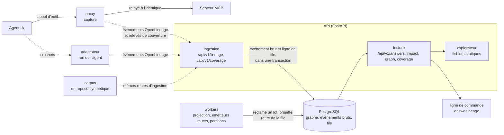
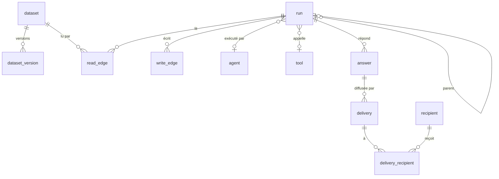

# Architecture

AnswerLineage est fait de services sans état autour d'un seul PostgreSQL. Ce document dit les composants, le chemin d'un événement de la capture à la lecture, le modèle de données, où chaque invariant du produit est tenu dans le code, et ce qui tourne où dans la démonstration. Les [concepts](concepts.md) en donnent le vocabulaire, et les [décisions d'architecture](decisions/README.md) disent pourquoi le code est ainsi.

## Les composants

Chaque composant est un membre de l'espace de travail uv, publié comme son propre paquet (voir [la décision sur le dépôt unique](decisions/0009-monodepot-publication-par-composant.md)). Ses sources sont dans `<composant>/src/answerlineage_<composant>/`, ses tests dans `<composant>/tests/`.

| Composant | Rôle | Dépend de | Documentation |
| --- | --- | --- | --- |
| `proxy/` | Proxy MCP transparent, en HTTP ou en stdio : relaie à l'identique, émet un événement par appel d'outil, analyse le SQL à côté de l'appel, publie ce qu'il a vu | `emitter` | [Proxy MCP](proxy.md) |
| `adapters/` | Adaptateurs d'agents : les crochets du Claude Agent SDK (extra `claude-agent-sdk`) émettent le run de chaque demande, de ses sous-agents et de ses appels d'outils, sans toucher à la logique de l'agent | `emitter` | [Adaptateurs d'agents](adaptateurs.md) |
| `emitter/` | Émetteur commun : empreintes HMAC à clé de locataire, identifiant de run dérivé du contexte de trace W3C, briques des événements OpenLineage et de leurs facettes, boîte d'envoi bornée vers l'API avec le jeton `client_credentials` du client | httpx seulement | [Proxy MCP](proxy.md#boîte-denvoi), [Facettes](facettes.md) |
| `api/` | Schéma du graphe, migrations, écriture du graphe, API d'ingestion OpenLineage, API de lecture du lignage, déclaration et lecture des incidents, lecture de leur liste de rappel, révélation journalisée d'un destinataire, route de santé, service de l'explorateur ; vérification des jetons OIDC et matrice des droits de chaque route | aucun autre composant | [Ingestion](ingestion.md), [lecture](lecture.md), [incidents](incidents.md), [schéma](schema.md), [authentification](securite/authentification.md) |
| `workers/` | File de traitement dans PostgreSQL, projection des événements dans le graphe, analyse d'impact des incidents déclarés et leur liste de rappel, contrôle des émetteurs muets, maintenance des partitions | `api` (schéma, écriture du graphe, propagation) | [Workers](workers.md) |
| `cli/` | La commande `answerlineage` : `impact`, `incident`, `doctor`, `demo`, `proxy`. Parle à l'API par HTTP, ne lit jamais la base | httpx seulement | [Ligne de commande](cli.md) |
| `corpus/` | Entreprise synthétique à vérité connue, corpus de vérité des incidents, corpus d'abus : tout est déterminé par une graine | bibliothèque standard seule | [Entreprise synthétique](corpus.md) |
| `conformance/` | Kit qui juge un émetteur : forme des événements, contexte de trace, absence de contenu par canaris, projection | `workers` | [Kit de conformité](conformite.md) |
| `ui/` | Explorateur : le graphe en cinq colonnes, les modes Remonter et Propager, les adresses partageables. Fichiers statiques servis par l'API | l'API de lecture, rien d'autre | [Explorateur](explorateur.md) |

Le proxy et l'API ne dépendent pas l'un de l'autre. Ce qu'ils doivent partager, le contrôle de l'hôte et de l'origine, la forme des identifiants, le contrat des événements, est écrit des deux côtés, et des tests qui croisent les composants (`tests/test_contract_guard.py`, `tests/test_contract_identifiers.py`, `tests/test_contract_proxy_ingestion.py`) les tiennent d'accord.

Ce que tout émetteur fait de la même façon, et qui est le plus sensible, est écrit une seule fois, dans l'émetteur commun (`emitter/`) : l'empreinte à clé qui remplace un contenu, l'identifiant de run qui dérive du contexte de trace, les briques de l'événement et de ses facettes, la boîte d'envoi et le jeton du client. Le proxy et les adaptateurs s'en servent, et chacun y ajoute ce qui lui est propre : le proxy, ce qu'il lit d'un appel relayé et le choix du contexte de trace (`_meta`, en-tête ou créé) ; un adaptateur, ce que les crochets de l'agent lui disent ; chacun, ses réglages et son journal. L'émetteur commun ne dépend d'aucun autre composant.

Hors de ces composants : `spec/` tient les contrats publiés (le schéma OpenLineage 2-0-2, les schémas des cinq facettes propres, l'API OpenAPI, les vecteurs de test des empreintes, des pseudonymes et de l'identifiant de run), `deploy/` l'image de la démonstration, `scripts/` les contrôles du pipeline, `tests/` les tests qui croisent plusieurs composants.

## Du capteur à la lecture

Le flux : capture, événements OpenLineage, ingestion, graphe, lecture.

**1. Capture.** Le proxy se place devant un serveur MCP. Il relaie chaque requête et chaque réponse octet pour octet, au fil de l'eau. Une fois l'échange fini, il construit un `RunEvent` OpenLineage : le job est `mcp://<serveur>` / `<outil>`, l'identifiant de run dérive du contexte de trace W3C de l'appel, les tables lues sont les `inputs`, et la facette `answerlineage_toolCall` dit le reste (outil, transport, issue, empreintes à clé). Pour un outil SQL, la requête est analysée dans un processus à part, après l'appel. Les événements et les relevés de couverture partent vers l'API par une boîte d'envoi en mémoire, bornée, hors du chemin des appels (`proxy/src/answerlineage_proxy/app.py`, `inspection.py`, `events.py`, `analyzer.py` ; la boîte d'envoi, les empreintes et l'identifiant de run dans `emitter/src/answerlineage_emitter/`).

Une demande d'agent est un run ; chaque appel d'outil, un run enfant que la facette standard `parent` rattache au premier ; les données lues sont les `inputs`. Un émetteur qui connaît l'agent émet le run de l'agent et la diffusion de sa réponse (facettes `answerlineage_agent` et `answerlineage_delivery`) : le corpus synthétique le fait. L'[adaptateur du Claude Agent SDK](adaptateurs.md) émet, depuis les crochets de l'agent, le run de chaque demande, de ses sous-agents et de ses appels d'outils, sans attendre l'envoi ; puis la diffusion de la réponse, que l'intégration lui déclare, ses destinataires pseudonymisés dans le processus de l'agent.

**2. Ingestion.** L'API reçoit les événements à `POST /api/v1/lineage` (un événement) et `/api/v1/lineage/batch` (jusqu'à 1 000), les relevés de couverture à `POST /api/v1/coverage`. Elle contrôle le corps (taille, compression, profondeur), valide l'événement selon le schéma officiel d'OpenLineage (traduit en modèles Pydantic, qu'un test compare au schéma), puis contrôle son heure et chacun de ses identifiants. Elle écrit l'événement brut dans `event_raw` et une ligne dans `ingest_queue`, dans la même transaction : un événement est donc soit reçu et à traiter, soit rejeté. Un événement déjà connu n'est pas enregistré deux fois, et est compté (`ingest/routes.py`, `body.py`, `models.py`, `store.py`).

**3. Projection.** Un worker réclame un lot de la file avec `FOR UPDATE SKIP LOCKED`, projette chaque événement dans le graphe (`workers/src/answerlineage_workers/projection.py`) et retire le lot de la file, dans une seule transaction : ni double traitement, ni perte. Plusieurs workers peuvent tourner. Un événement fautif est remis à plus tard, de plus en plus espacé, sans bloquer le lot. L'écriture du graphe (`api/src/answerlineage_api/store/graph.py`) est idempotente et commutative : rejouer un événement, ou en recevoir deux dans le désordre, donne le même graphe. Les événements bruts restent dans `event_raw` : le graphe se reconstruit en les rejouant.

**4. Lecture.** L'API de lecture (`api/src/answerlineage_api/lineage/`) interroge le graphe dans les deux sens. Les sources d'une réponse sont les lectures de son run et de ses runs enfants (`trace.py`). La vue en cinq colonnes part des réponses les plus récentes et donne à chacune sa chaîne (`overview.py`). La propagation part des lectures d'un jeu de données dans une fenêtre et remonte aux runs parents (`impact.py`). La couverture compare les relevés des émetteurs au graphe (`coverage.py`). Toute lecture est bornée en lignes et en durée, et dit quand elle est tronquée. L'explorateur et la commande `answerlineage` ne lisent que cette API.

**L'accès.** Chaque route de l'API exige un jeton porteur JWT de l'émetteur OIDC de l'entreprise et un rôle : six rôles de personnes, lus dans une revendication du jeton, et le rôle technique d'émetteur, lu de l'identifiant du client. Une dépendance posée sur toute l'application vérifie le jeton (clés du JWKS de l'émetteur, en cache) et applique la matrice des droits, déclarée une fois dans le code et publiée dans l'OpenAPI, avant les paramètres et le corps de la route (`api/src/answerlineage_api/auth/`). Le proxy obtient son jeton par l'octroi `client_credentials`, la ligne de commande lit le sien d'une variable ou d'un fichier, l'explorateur se connecte par le flux d'autorisation avec PKCE ([Authentification et rôles](securite/authentification.md)).

**À côté du flux,** les workers analysent les incidents déclarés par l'API : ils réclament chaque demande d'analyse comme un lot de la file, lancent la propagation sur le périmètre et la fenêtre de l'incident, et en gardent le résultat ([incidents](incidents.md)), avec sa liste de rappel : un message par destinataire, les plus exposés d'abord ([liste de rappel](rappel.md)). Ils contrôlent aussi chaque minute les émetteurs muets, et entretiennent chaque heure les partitions mensuelles des tables qui grossissent avec le trafic.

## Le modèle de données

Le schéma est déclaré dans `api/src/answerlineage_api/store/schema.py` ; les migrations Alembic le créent, et un test compare la base migrée au schéma déclaré. Le détail de chaque table est dans [Schéma du graphe](schema.md).

- **Le graphe** : `agent`, `tool`, `dataset`, `dataset_version`, `run`, `read_edge`, `write_edge`, `answer`, `delivery`, `delivery_recipient`, `recipient`. Un run a un parent (run d'agent ou run d'outil) ; une lecture relie un run à un jeu de données, avec son niveau de précision, ses colonnes et l'intervalle de ses heures ; une réponse est une empreinte, une diffusion un canal et une référence de message, un destinataire un pseudonyme.
- **Ce qui est reçu** : `event_raw` (l'événement tel que reçu, rejouable), `ingest_queue` (les événements à projeter), `ingest_duplicate` (les doublons, par émetteur et par jour).
- **Ce que les émetteurs disent d'eux** : `coverage_report` (un relevé par émetteur, instance et fenêtre), `coverage_emitter` (l'émetteur connu, son dernier relevé, son silence), `partition_alert` (une partition manquante signalée).
- **Deux heures** sur chaque ligne datée : l'heure de l'événement, déclarée par l'émetteur, et l'heure d'enregistrement, la réception par AnswerLineage de l'événement qui a fait connaître la ligne. La seconde permet de lire le graphe tel qu'il était connu à une date.
- **Partitions.** `event_raw`, `coverage_report` et `ingest_duplicate` sont partitionnées par mois de réception, créées à l'avance et purgées au bout de la conservation (13 mois par défaut). Le graphe, lui, n'est pas partitionné ni purgé.

Aucune colonne ne porte de contenu : des noms, des empreintes, des pseudonymes, des heures et des nombres. À côté du graphe, `recipient_revelation` journalise chaque révélation d'un destinataire, en ajout seul, sans l'identité révélée ; `recall_list` et ses entrées tiennent la liste de rappel de chaque incident analysé, sous les pseudonymes.

## Où chaque invariant est tenu

Un changement qui viole un invariant est faux, même si ses tests passent. Voici les huit, et l'endroit où chacun se tient.

| Invariant | Où dans le code | Ce qui le vérifie |
| --- | --- | --- |
| **1. Aucun contenu stocké, journalisé ni mis en métrique : des empreintes seulement** | `fingerprint.py` (HMAC à clé) dans l'émetteur commun ; les crochets de l'adaptateur, qui ne lisent ni prompt, ni message d'erreur, ni réponse, et n'envoient arguments et résultat qu'en empreintes, comme la réponse que l'intégration déclare diffusée (`adapters/.../claude_agent_sdk.py`) ; `sql.py` et `analyzer.py` (forme sans littéraux), `events.py` (ce qui entre dans l'événement) dans le proxy ; aucun champ de contenu dans `store/schema.py` ; journaux des bibliothèques coupés (`sql.py`, `app.py`, `outbox.py` de l'émetteur commun, `cli/client.py`), journal d'accès de l'API coupé dans `compose.yaml` | Un test canari par composant (par exemple `tests/test_conformance_no_content.py`, `tests/test_conformance_adapter.py`, `tests/test_no_token_anywhere.py`, `cli/tests/test_logs.py`), le kit de conformité, le corpus d'abus |
| **2. Aucun modèle : tout résultat est déterministe** | Aucune dépendance à une bibliothèque de modèle ; la propagation est une requête SQL bornée (`lineage/impact.py`) ; le corpus se génère d'une graine | `tests/test_truth_corpus_impact.py` mesure le moteur sur la vérité connue : rappel d'au moins 0,99 |
| **3. La capture ne bloque ni ne retarde jamais un agent ; elle reste ouverte en cas de panne** | Le relais rend la réponse au fil de l'eau et construit l'événement après l'échange (`app.py`) ; la boîte d'envoi de l'émetteur commun prend en charge un événement par un ajout en mémoire (`emitter/.../outbox.py`) ; l'analyse du SQL tourne dans un processus à part, sous budget (`sql.py`, `analyzer.py`) ; à l'arrêt, le proxy sert encore le temps d'être retiré de la rotation, puis laisse aux appels en cours un délai de grâce (`lifecycle.py`) ; chaque crochet de l'adaptateur rend aussitôt une sortie asynchrone, et l'événement se construit à côté (`adapters/.../claude_agent_sdk.py`) | `tests/test_outbox_chaos.py` (API coupée, puis muette, puis rétablie), `make bench` (p99 de la latence ajoutée au plus 5 ms, chaque nuit), `proxy/tests/test_replicas.py` (deux réplicas sous charge, l'un arrêté : aucun appel n'échoue), `adapters/tests/test_claude_agent_sdk.py` (une API pendante ne retient aucun crochet) |
| **4. Le proxy ne termine pas OAuth et ne conserve aucun jeton** | Le proxy relaie les en-têtes et le corps tels quels, y compris le défi `401` et les métadonnées OAuth du serveur (`app.py`) ; il ne lit pas `Authorization` ; le mode passerelle, où un jeton lié à l'URL du serveur ne passerait qu'en terminant OAuth, est refusé devant un tel serveur (`resource.py`). L'invariant vise les jetons du trafic MCP des agents. Le jeton propre du proxy envers l'API d'AnswerLineage, obtenu par l'octroi `client_credentials` et gardé en mémoire (`credentials.py` de l'émetteur commun), est son identité d'émetteur : il ne sert à aucun appel relayé ([Le jeton du proxy](proxy.md#le-jeton-du-proxy-envers-lapi)) | `proxy/tests/test_authorization.py`, `proxy/tests/test_modes.py`, `tests/test_no_token_anywhere.py` : un jeton accepté par un serveur protégé traverse tout le parcours, puis on le cherche partout ; `proxy/tests/test_credentials.py` : le secret et le jeton du proxy ne sont ni journalisés ni affichés |
| **5. PostgreSQL est la seule dépendance obligatoire** | La file est une table (`workers/.../queue.py`), les verrous sont des verrous consultatifs, aucun autre service dans `compose.yaml` | `tests/test_no_sqlite.py`, `make policy` sur le fichier compose |
| **6. Toute entrée est hostile : un identifiant reçu n'est recopié que s'il a une forme admise, et toute entrée est bornée** | `api/.../identifiers.py`, `ingest/body.py`, `ingest/models.py` ; `proxy/.../names.py`, `prefix.py`, `rules.py` ; la diffusion des quarantaines, bornée et lue par le proxy seulement si sa signature et son heure sont valides (`quarantine.py`, `quarantine_signature.py`) ; contrôle Host et Origin avant tout dans `guard.py`, écrit dans le proxy et dans l'API ; lectures bornées et sous délai (`lineage/reading.py`), erreurs sans la valeur reçue (`responses.py`) | Le corpus d'abus (175 attaques) rejoué à chaque merge request (`make abuse`), `tests/test_contract_guard.py`, `tests/test_contract_identifiers.py`, `proxy/tests/test_quarantine_signature.py` |
| **7. Tout texte produit suit un gabarit fixe** | Les messages de la commande, de `doctor` et des erreurs de l'API sont écrits d'avance et ne recopient pas de valeur reçue ; l'explorateur affiche des messages fixes ; un webhook annonce un incident par un message à gabarit fixe et fermé, publié (`workers/.../webhooks.py`, `spec/webhooks/v1/Message.json`) | `cli/tests/test_hostile.py`, `tests/test_abuse_explorer.py`, `workers/tests/test_webhooks.py`. Aucun texte n'est encore produit pour un destinataire : le rappel n'existe pas |
| **8. Aucun rappel ne part sans validation humaine ; destinataires pseudonymisés, sans table de correspondance** | Le rappel n'est pas construit : aucun code n'envoie quoi que ce soit à un destinataire. Les [webhooks](webhooks.md) annoncent un incident au récepteur de l'exploitant, jamais à un destinataire, et ne comptent les destinataires qu'en nombre. Le destinataire n'entre que sous son pseudonyme HMAC, calculé par l'émetteur sous une clé que la base ne tient pas (`emitter/.../pseudonym.py`, pour l'adaptateur) : l'ingestion refuse toute autre forme (`ingest/models.py`), la projection l'ignore (`workers/.../projection.py`). La révélation recalcule le HMAC d'identités candidates avec la clé du coffre et ne garde que le journal de l'action, en ajout seul (`pseudonyms/`, [pseudonymes](securite/pseudonymes.md)) | `tests/test_pseudonymized_recipients.py` : un parcours complet, puis la base entière parcourue sans trouver d'identité ni la clé ; `tests/test_delivery_end_to_end.py` : de l'adaptateur au graphe, les identités pseudonymisées dans le processus de l'agent ; `api/tests/test_revelation.py`, le corpus d'abus (le lecteur qui révèle) |

L'invariant 1 se vérifie au plus près de l'émetteur par le [kit de conformité](conformite.md), qui cherche des canaris dans les événements, les journaux et les métriques ; l'invariant 6 par le [corpus d'abus](corpus.md#corpus-dabus).

## Ce qui tourne où dans la démonstration

`docker compose up` ([démonstration](demonstration.md)) lance, depuis une seule image construite des sources verrouillées :

| Service | Processus | Ce qu'il fait |
| --- | --- | --- |
| `postgres` | PostgreSQL 18 | La base, seule dépendance. Non publiée : joignable des seuls autres services |
| `migrate` | `python -m answerlineage_api.store.migrate upgrade` | Crée ou met à jour le schéma, puis s'arrête |
| `api` | `uvicorn` sur le port 8000 | L'ingestion, la lecture et l'explorateur, qu'elle sert depuis `/opt/answerlineage-ui`. Seul port publié, sur `127.0.0.1`. Son authentification est désactivée par un réglage nommé (`ANSWERLINEAGE_AUTH=disabled`), pour la boucle locale seule |
| `worker` | `answerlineage-worker` | Projette les événements dans le graphe, analyse les incidents déclarés, contrôle les émetteurs muets, entretient les partitions |
| `seed` | `answerlineage-corpus load` | Envoie l'entreprise synthétique à l'API, puis s'arrête. Partage l'espace réseau de l'API : il la joint par `127.0.0.1` |

Le proxy ne tourne pas dans la démonstration : les événements viennent de l'entreprise synthétique, qui les construit comme le proxy le ferait, et non d'agents réels. L'image contient pourtant le proxy, le kit de conformité et la ligne de commande : `docker compose exec api answerlineage doctor` vérifie l'installation de l'intérieur.

Les données empruntent le chemin réel : ingestion, file de traitement, worker, graphe. Rien n'est écrit directement dans la base.

## Pour aller plus loin

- Pourquoi PostgreSQL seul, pourquoi OpenLineage, pourquoi aucune empreinte sans clé : [les décisions d'architecture](decisions/README.md).
- Écrire un émetteur : [Facettes](facettes.md) et [Kit de conformité](conformite.md).
- Les limites connues de chaque composant sont en fin de leur document.
