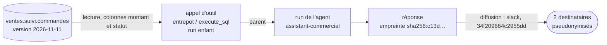

# Concepts

Le vocabulaire du produit, chaque mot en quelques lignes, avec un exemple pris dans l'[entreprise synthétique](corpus.md) livrée avec le dépôt (graine par défaut). Les exemples sont ceux de la [démonstration](demonstration.md) : on peut les retrouver dans l'explorateur et dans l'API.

Une demande de l'entreprise sert de fil rouge. L'assistant commercial (`agent://ventes`) reçoit une demande le 11 novembre 2026 à 9 h 17 UTC. Il fait trois appels d'outils, dont un à `execute_sql` du serveur `entrepot`, qui lit les colonnes `montant` et `statut` de la table `ventes.suivi.commandes`. Il répond sur Slack à deux personnes. Cette table sera reconnue fausse : sa réponse fait partie des réponses touchées.

## Les données

**Jeu de données.** Ce qu'un agent peut lire ou produire : une table, un document, une API, une mémoire, ou une réponse (`dataset`, `kind`). Il se désigne par un espace de noms et un nom, selon les conventions d'OpenLineage : `bigquery` et `ventes.suivi.commandes`, ou `postgres://crm:5432` et `crm.public.comptes`. L'entreprise en compte 13, dix dans l'entrepôt, trois dans des bases opérationnelles.

**Version.** L'état d'un jeu de données à un moment donné, quand l'émetteur la déclare. Les tables de l'entrepôt sont rechargées chaque nuit : la lecture du 11 novembre porte la version `2026-11-11`. Les tables des bases opérationnelles n'ont pas de version.

**Lecture et niveau de précision.** Une lecture relie un run à un jeu de données, avec le niveau auquel l'émetteur sait dire ce qui a été lu : `table` (tout le jeu de données, ou on ne sait pas mieux), `columns` (une liste de colonnes), `subset` ou `keys` (un sous-ensemble ou des lignes). Notre appel lit `ventes.suivi.commandes` au niveau `columns` : `montant`, `statut`. Quand le proxy ne peut pas établir la liste complète des colonnes, il déclare la table entière : une colonne manquante ferait écarter à tort une réponse touchée. La [propagation](lecture.md#limites-connues) ne descend pas encore sous la table ; les niveaux plus fins sont mesurés sur le [corpus de vérité](corpus.md#corpus-de-vérité).

## Les appels

**Run, et run enfant.** Un run est une exécution, au sens d'OpenLineage, identifiée par un UUID. Une demande faite à un agent est un run (`01a1c9e6-3a18-7c5c-b8b5-fce292591000`). Chaque appel d'outil de cette demande est un run enfant, rattaché au premier par la facette standard `parent` : celui de notre appel SQL est `01a1c9e6-7898-7066-9cf5-86e5cf095df3`. L'arbre peut être plus profond : un sous-agent est un run enfant qui a ses propres enfants. Les sources d'une réponse sont les lectures de son run et de tous ses descendants.

**Appel d'outil.** Un appel MCP (`tools/call`) d'un agent à un serveur. Le proxy en émet un événement et un seul : job `mcp://entrepot` / `execute_sql`, facette `answerlineage_toolCall` (serveur, outil, transport, issue), tables lues en entrée. Un outil qui ne dit pas ce qu'il lit est marqué « non décrit » ([règles de lecture](proxy.md#règles-de-lecture-des-outils-non-sql)).

## Les réponses

**Réponse.** Ce que l'agent a rendu à la fin de son run : une sortie qui porte la facette `answerlineage_delivery`. AnswerLineage n'en garde que l'empreinte (`sha256:c13d010082a2…`), jamais le texte. Son identifiant, `01a1c9e63a187c5cb8b5fce292591000424d79573035c170`, se déduit du run et de l'empreinte : il reste le même si le graphe est reconstruit, et peut figurer dans un ticket.

**Diffusion.** L'envoi d'une réponse par un canal : `slack`, avec la référence du message, `34f209664c2955dd`. C'est ce que connaît le destinataire d'un message, et ce par quoi il retrouve la réponse ([Remonter](lecture.md#remonter-dune-réponse-à-ses-sources)).

**Destinataire pseudonymisé.** Une personne qui a reçu une réponse, sous un pseudonyme : `hmac-sha256:4e505884373d04f5b52cbfaa1837d28134d2933fb75751684ca225a51b76f4d0`. L'émetteur de la diffusion le donne ainsi, calculé par un HMAC sous la clé du locataire : AnswerLineage ne reçoit pas d'identité et ne garde aucune table de correspondance. Un gestionnaire d'incident peut [révéler](securite/pseudonymes.md#la-révélation) un destinataire parmi des identités qu'il apporte, et l'action est journalisée.

## Qui capte, et ce qu'il a vu

**Émetteur.** Ce qui produit des événements : un proxy devant un serveur MCP, un adaptateur d'agent, un serveur d'envoi. Il s'identifie par l'espace de noms de ses jobs : `mcp://entrepot` pour le proxy placé devant le serveur `entrepot`. Le [kit de conformité](conformite.md) vérifie un émetteur.

**Instance.** L'un des processus d'un même émetteur. Plusieurs proxys placés devant un même serveur partagent l'émetteur, chacun publie sous son identifiant d'instance (`proxy-entrepot-7f9c`), et la couverture les additionne au lieu de les confondre.

**Couverture.** La part des appels que le lignage a réellement captés. Chaque émetteur publie, fenêtre par fenêtre, un relevé : appels vus, événements émis, perdus, requêtes non inspectées. L'API compare ces relevés au graphe, qui fait foi. La couverture est `measured` (des relevés couvrent toute la période), `partial` ou `unknown` (aucun relevé : on ne sait pas). Pour l'incident de l'entreprise, elle est mesurée à 100 %, sans trou. « Aucune réponse touchée » ne vaut que sur une couverture mesurée et sans trou.

**Trou de lignage.** Un endroit connu où le lignage a pu manquer un appel : `events_lost` (l'émetteur a perdu des événements), `missing_from_graph` (le graphe contient moins d'événements que d'appels vus), `uninspected` (des requêtes relayées sans pouvoir être lues), `silence` (aucun relevé sur un intervalle), `before_first_report` (la période commence avant le premier relevé). Un trou dans la fenêtre d'un incident appelle une vérification à la source de l'émetteur nommé. Un émetteur qui cesse de publier est signalé *muet* au bout de dix minutes.

## Lire le graphe

**Propagation.** Du jeu de données vers les personnes : les réponses touchées par une table fausse pendant une fenêtre, et leurs destinataires. Pour `ventes.suivi.commandes`, fausse du 11 novembre à 6 h au 12 à midi : 16 réponses, 13 destinataires. Une réponse est touchée quand un run de son arbre a lu le jeu de données pendant la fenêtre : c'est l'heure de la lecture qui compte, pas celle de la réponse.

**Remontée.** De la réponse vers ses sources : les jeux de données lus, leurs versions et leurs colonnes, les outils appelés, l'agent. Notre réponse remonte à quatre jeux de données (la table des commandes, le catalogue produit, les comptes et les opportunités du CRM), par deux serveurs d'outils.

**Heure d'événement et heure d'enregistrement.** Chaque ligne du graphe porte deux heures : ce qui s'est passé selon l'émetteur (`eventTime`), et ce qu'AnswerLineage en savait, c'est-à-dire la réception du premier événement qui l'a fait connaître. Notre lecture est datée du 11 novembre à 9 h 18 UTC par l'émetteur ; elle a été enregistrée quand l'API a reçu l'événement. La seconde permet de lire le graphe « tel que connu à » une date (`known_at`) : quelles réponses un rappel décidé mardi pouvait-il trouver ? Une lecture garde en plus sa première et sa dernière heure d'événement : un événement rejoué avec une heure antérieure élargit l'intervalle sans faire sortir la lecture de la fenêtre.

## Ce que le produit garde

**Empreinte.** Ce qui tient lieu de contenu. L'empreinte d'une réponse la désigne sans la contenir. Celles que calcule le proxy pour les arguments et le résultat d'un appel sont des HMAC-SHA-256 avec une clé propre à l'organisation (`hmac-sha256:…`) : deux appels identiques se reconnaissent, et qui n'a pas la clé ne peut pas retrouver une valeur peu variée en essayant des candidates. Sans clé, aucune empreinte n'est émise. Ni prompt, ni résultat d'outil, ni réponse n'est stocké.

## Rappel

Le mot a deux sens dans le projet, et il faut les distinguer.

- **Le rappel qu'on fait :** notifier les destinataires d'une réponse fausse, après validation humaine. C'est ce que le produit vise ; il n'existe pas encore. Aucun message ne part d'AnswerLineage aujourd'hui, et aucun ne partira sans validation.
- **Le rappel qu'on mesure (*recall*) :** la part des réponses touchées que la propagation retrouve. C'est la mesure qui compte, parce qu'une réponse touchée oubliée est un destinataire qu'on ne préviendra pas. Elle est mesurée sur le corpus de vérité, qui exige 0,99 au niveau table à chaque merge request ([mesure du moteur d'impact](corpus.md#mesure-du-moteur-dimpact)).

Le contexte tranche : une phrase sur des destinataires, un message ou une validation parle de la notification ; une phrase sur un seuil, une part ou une précision parle de la mesure.
