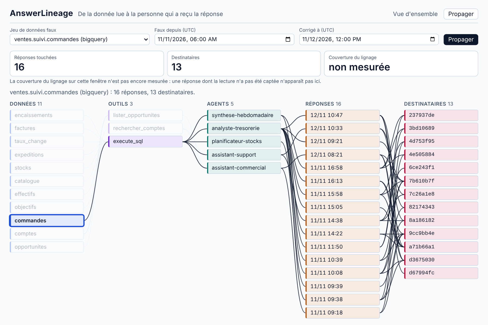
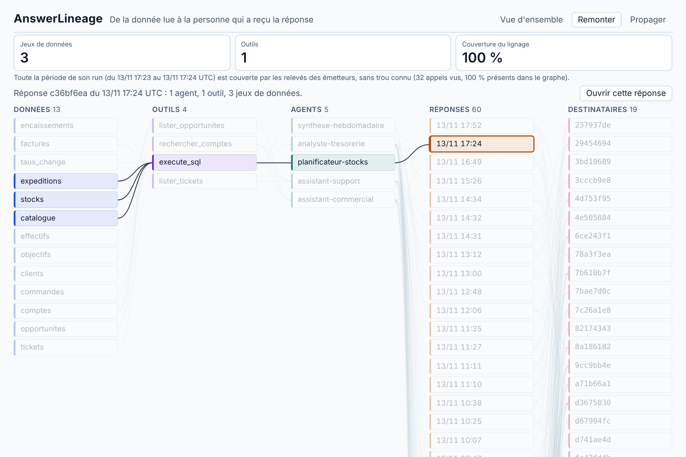

# Explorateur

L'explorateur montre le lignage en cinq colonnes, des données aux personnes : jeux de données, outils, agents, réponses, destinataires. Il se lit dans un navigateur, sans compte ni installation.



## Le lancer

L'interface est faite de fichiers statiques, que l'API sert à sa racine. Elle se construit une fois, avec Node 22 :

```bash
make ui
```

Puis l'API reçoit le dossier construit :

```bash
ANSWERLINEAGE_UI_DIR=ui/dist uv run uvicorn --factory answerlineage_api.app:create_app
```

L'explorateur est alors sur `http://127.0.0.1:8000/`. Sans `ANSWERLINEAGE_UI_DIR`, l'API ne sert aucune page.

## Ce qu'il montre

| Vue | Adresse | Contenu |
| --- | --- | --- |
| Vue d'ensemble | `#/` | Les 60 réponses les plus récentes et tout ce qu'elles touchent |
| Jeu de données | `#/donnees?namespace=…&name=…` | La vue d'ensemble, ce jeu de données choisi |
| Réponse | `#/reponse/<identifiant>` | Une réponse et sa chaîne : ce qu'elle a lu, par quels outils, pour qui |
| Remonter | `#/remonter`, `#/remonter/<identifiant>` | Les réponses les plus récentes ; une réponse choisie, et son chemin jusqu'aux données |
| Propager | `#/propager?namespace=…&name=…&from=…&to=…` | Un incident : les réponses et les destinataires touchés |

Survoler ou choisir un nœud met sa chaîne en évidence. Depuis une donnée, on suit ce qui en dépend : les outils qui l'ont lue, les agents, les réponses, les destinataires. Depuis une réponse ou un destinataire, on remonte à ce qui a été lu.

**Remonter.** Le destinataire d'une réponse veut vérifier d'où elle vient. En mode Remonter, il choisit une réponse parmi les plus récentes, d'un clic ou au clavier : seuls la réponse, son agent, ses outils et ses jeux de données restent en évidence, avec les liens qui les relient. Tout le reste s'efface sans disparaître, ses destinataires comme les autres réponses. Au-dessus du graphe, les jeux de données et les outils comptés, et la couverture du lignage sur la période de son run, par les émetteurs qui l'ont vu ([ce que la remontée peut manquer](lecture.md#ce-que-la-remontée-peut-manquer)) : son taux, « partielle » ou « non mesurée », la phrase qui dit ce qu'une source peut manquer et la liste des trous connus, comme en mode Propager. Survoler un autre nœud montre ce dont il dépend. Une réponse qui n'est plus parmi les plus récentes, ouverte par son adresse, s'affiche avec sa seule chaîne. La page d'une réponse mène à ce mode, et ce mode à la page de la réponse.



**Propager.** Le mode Propager prend un jeu de données et la période pendant laquelle il a été faux. Les réponses et les destinataires touchés s'allument, et trois compteurs s'affichent : réponses touchées, destinataires, couverture du lignage. La couverture dit ce que le résultat peut manquer ([couverture du lignage](lecture.md#couverture-du-lignage)) : son taux quand des relevés couvrent toute la fenêtre, « partielle » quand ils n'en couvrent qu'une part, « non mesurée » quand aucun ne la touche. En dessous, une phrase dit ce que cela veut dire pour ce résultat, et la liste des trous connus de la fenêtre nomme pour chacun son émetteur, sa nature (événements perdus, événements absents du graphe, requêtes non inspectées, silence, début avant le premier relevé) et sa fenêtre. Le taux est arrondi par défaut : 99,96 % s'écrit « 99,9 % », jamais « 100 % ». Quand la propagation dépasse ses bornes, les compteurs s'écrivent « au moins … » et un avis dit que le résultat est partiel : un résultat tronqué sans réponse ne s'affiche jamais comme « aucune réponse ». Une lecture interrompue par son délai maximal le dit aussi ([bornes et délais](lecture.md#bornes-et-délais)).

**Adresses.** L'adresse de la page dit ce que l'explorateur montre. Copiée dans un ticket ou un message, elle rouvre le même incident, la même réponse ou le même jeu de données, dans le même mode. L'identifiant d'une réponse reste valable si le graphe est reconstruit. Une adresse qui ne désigne aucune réponse connue, mal formée ou inconnue du graphe, affiche un message fixe, « Cette réponse n'est pas connue du graphe. » ; une valeur qui n'a pas la forme d'un identifiant n'est jamais envoyée à l'API.

## Ce qu'il ne fait pas

L'explorateur ne lit que l'[API de lecture](lecture.md) : il n'affiche aucun contenu de prompt, de résultat d'outil ou de réponse, parce que l'API n'en a pas. Une réponse est une heure et une empreinte, un destinataire est un pseudonyme.

Il ne charge rien d'ailleurs. L'API le sert sous une politique de sécurité du contenu qui n'autorise que ses propres fichiers : ni script ni style en ligne, aucune ressource tierce, aucune inclusion dans une autre page. L'application pose cette politique et ses autres en-têtes de sécurité sur toute réponse, page d'erreur comprise (fichier absent, méthode refusée, plage d'octets impossible) ; seule la durée de conservation est propre aux fichiers : les fichiers à empreinte de `assets/` sont gardés un an, la page n'est jamais gardée.

## Développer l'interface

```bash
npm ci --prefix ui && npm run --prefix ui dev
```

Le serveur de développement écoute sur `http://127.0.0.1:5173` et relaie `/api` vers une API lancée sur le port 8000.

| Commande | Usage |
| --- | --- |
| `make ui` | Installe les paquets verrouillés, contrôle les types, construit `ui/dist` |
| `make e2e` | Pilote l'explorateur construit dans Chromium, sur l'entreprise synthétique |

Les tests de bout en bout comparent ce que la page affiche à l'entreprise générée : les cinq colonnes et leurs liens en moins de 2 secondes, rien qui déborde sur un écran de 400 pixels de large, la chaîne allumée d'un jeu de données, les compteurs d'un incident, sa couverture mesurée, mesurée avec un trou, partielle ou non mesurée, le chemin d'une réponse en mode Remonter, choisie à la souris ou au clavier, et sa couverture, les adresses rouvertes dans un nouvel onglet, une adresse hostile qui n'amène qu'un message fixe. Une erreur dans la console du navigateur, refus de la politique de contenu compris, fait échouer le test.

Les sources sont dans `ui/src/` : `graph.ts` déduit les liens, la chaîne d'un nœud et ce dont il dépend, `route.ts` lit et écrit l'adresse, `CoverageNote.tsx` écrit la couverture d'un incident ou d'une remontée, `TraceView.tsx` tient le mode Remonter, `Graph.tsx` dessine les colonnes et trace les liens en SVG.

## Limites connues

- La vue d'ensemble montre 200 réponses au plus, et une propagation les 200 réponses touchées les plus récentes ; les compteurs, eux, portent sur tout l'incident.
- Le mode Remonter part des 60 réponses les plus récentes. Une réponse plus ancienne s'y ouvre par son adresse, ou depuis sa page ; le destinataire qui n'a que la référence de son message la retrouve par l'[API de lecture](lecture.md#remonter-dune-réponse-à-ses-sources).
- Les heures sont en UTC.
- L'interface est en français, en thème clair, et n'a pas encore passé d'audit d'accessibilité.
- L'explorateur n'a pas de contrôle d'accès : il est fait, à ce stade, pour la boucle locale.
